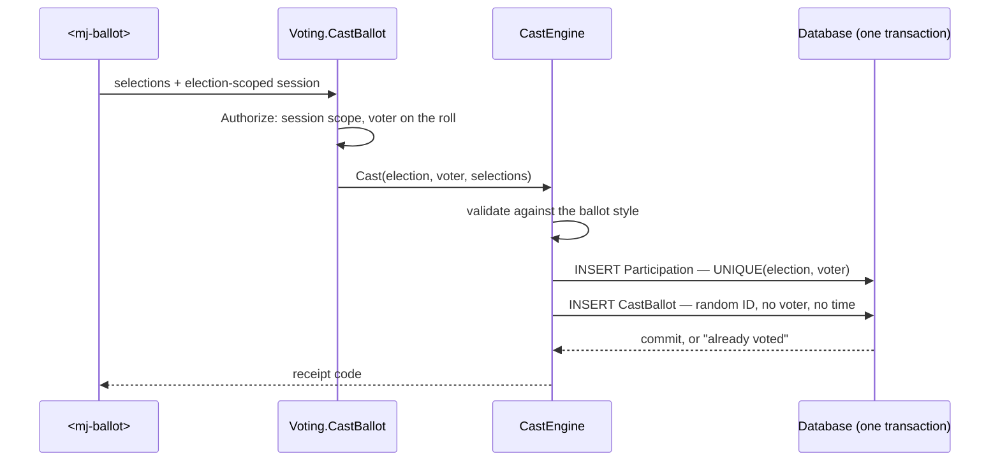
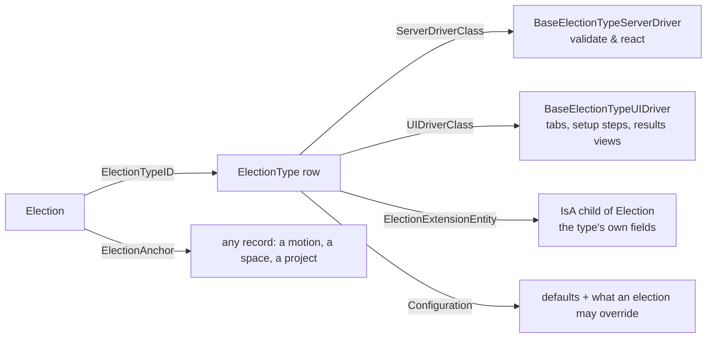

<p align="center">
  <picture>
    <source media="(prefers-color-scheme: dark)" srcset="https://github.com/MemberJunction/MJ/raw/main/MJ_logo_dark.png">
    <source media="(prefers-color-scheme: light)" srcset="https://github.com/MemberJunction/MJ/raw/main/MJ_logo.webp">
    
  </picture>
</p>

<h1 align="center">BizApps Voting</h1>

<p align="center">
  <strong>Secret, verifiable, embeddable voting — motions, elections, referendums and polls — for the <a href="https://github.com/MemberJunction/MJ">MemberJunction</a> platform</strong>
</p>

<p align="center">
  <a href="#what-this-is--and-is-not">What this is</a> &middot;
  <a href="#how-a-secret-ballot-works-here">Secret ballots</a> &middot;
  <a href="#results-on-your-terms">Results timing</a> &middot;
  <a href="#election-types-are-plug-ins">Plug-ins</a> &middot;
  <a href="#the-ballot-widget">Ballot widget</a> &middot;
  <a href="#using-bizapps-voting-in-your-code">Code</a> &middot;
  <a href="#roadmap">Roadmap</a> &middot;
  <a href="plans/bizapps-voting-design.md">Design</a>
</p>

<p align="center">
  
  
  
  
  
  
</p>

---

> **Status: design approved, build starting.** This README describes the system the
> [design](plans/bizapps-voting-design.md) commits to. Code samples show the target API. Nothing
> here is shipped yet; the [roadmap](#roadmap) says what lands when.

Organizations vote all the time, and in many shapes:
- A board passes a motion.
- Members elect a slate of directors.
- A union ratifies a contract.
- A co-op approves a bylaw amendment.
- A standards body ballots a draft and resolves the comments.
- A team runs a quick poll and watches the results come in.

Each of these needs the same guarantees:
- only eligible people vote;
- each votes once;
- nobody can see how anyone else voted, unless the vote is a roll call;
- the count can be reproduced and certified.

**BizApps Voting** is one voting engine for every app built on MemberJunction. It is a **MemberJunction Open App**: install it into any MJ environment and every other app (Committees, Collaboration, your own) can hold a vote by anchoring an election to its records and dropping a ballot onto any page.

The design stands on three ideas:

1. **The server decides everything.** Eligibility, casting, tallying and certification run in server engines exposed through typed [Remote Operations](https://github.com/MemberJunction/MJ/blob/next/guides/REMOTE_OPERATIONS_GUIDE.md). The ballot renders and submits; it decides nothing.
2. **Secret by construction, not by permission.** *Who voted* and *what was voted* live in separate stores with no link between them. That includes the timestamps, row ordering and audit trails a database adds by default.
3. **Configuration is data, and every type is a plug-in.** Election types, tally methods, eligibility sources and sign-in methods are metadata rows naming registered driver classes, the same model as BizApps Collaboration's space types.

---

## What This Is — and Is Not

| ✅ This is | ❌ This is not |
|---|---|
| A voting engine for motions, board and organization-wide elections, amendments, referendums, ratifications, polls and standards ballots | A survey tool. Surveys belong in [BizApps Forms](https://github.com/MemberJunction/bizapps-forms), which links responses to respondents on purpose |
| **Secret ballots by construction**: separate poll book and ballot box, MJ's side channels closed | A judging or scoring tool (awards, abstracts): that's rubric scoring, not voting |
| **Open** (roll call), **Confidential** (sealed until close) and **Secret** modes, chosen per election | A government or public-company proxy-voting system |
| An embeddable `<mj-ballot>` widget with several sign-in methods, for any page | A membership, HR or student system. Voter rolls come from whichever system of record you already run |
| Plurality, majority with thresholds, approval, ranked-choice (IRV/STV), weighted and representative voting | Coercion-resistant remote voting. No remote system can promise that, and we don't claim it |
| Pluggable: types, tally methods, eligibility sources and sign-in methods are driver classes | Tied to any one vertical: nothing in the engine names a host app |

---

## How a Secret Ballot Works Here

Real elections keep two records apart: the **poll book** (who voted) and the **ballot box** (what was voted). One server operation writes both, in one transaction:



**Guarantees this gives:**
- A voter can't vote without being marked as having voted, and can't be marked without voting.
- A second attempt fails on the unique constraint, whichever sign-in method or channel it came through: online, paper or proxy.

The foreign key is the easy part. Secrecy is usually lost through the **side channels**, so the design closes each one explicitly:

| Side channel | Control |
|---|---|
| Automatic `__mj_CreatedAt` / `__mj_UpdatedAt` columns | `TrackRecordChanges = 0` on ballot entities: no timestamp columns, no Record Changes rows naming the user |
| Sequential IDs that sort ballots in insert order | Random `NEWID()` keys |
| Rows saved under the voter's own session | Ballots are written by the system user; the voter's identity stops at the poll book |
| Generated GraphQL access | `IncludeInAPI = 0`; no role reads ballot tables; only the tally engine does, and only after close |
| Request and audit logs | The cast operation never logs its input |
| Unique vote weights | Weights stay off the ballot; tallies are per weight class with a minimum class size |
| Operators and DBAs during voting | Assurance tier B: selections are encrypted under an election key that trustees split and the server never holds |

### Secrecy modes and assurance tiers

| Mode | For | What's stored |
|---|---|---|
| **Open** | Roll-call votes, standards ballots | Each vote linked to the voter, visible per policy |
| **Confidential** | Committee votes that need a record but stay sealed until close | Each vote linked to the voter, readable only by them until close |
| **Secret** | Organization-wide elections, sensitive motions, anonymous polls | Poll book and ballot box, unlinkable |

| Tier | Protects against | How |
|---|---|---|
| **A — Standard** | Other voters, staff, the generic API | The controls above, plus field encryption at rest |
| **B — High assurance** | Operators and DBAs during the vote | A per-election key pair; the private key is split among trustees (*k*-of-*n*) and combined only in a tally ceremony; ballots are shuffled before decryption |
| **C — Verifiable** | Anyone who doubts the count | [ElectionGuard](https://github.com/microsoft/electionguard) integration: homomorphic tally, voter tracking codes, published verification artifacts |

---

## Results, On Your Terms

Each election chooses when results appear (`ResultsTiming`) and who sees them (`ResultsAudience`):

| ResultsTiming | Who sees running results | Typical use |
|---|---|---|
| `AfterClose` (default) | Nobody; turnout only | Elections, motions, amendments |
| `AfterVoting` | Each voter, once they've voted | Polls where early results would sway the undecided |
| `Live` | The results audience, throughout | Open polls, straw votes |
| `AdministratorsOnly` | Administrators, for monitoring; every view is audited | Rarely; disclosed on the certification |

Running totals don't touch ballot secrecy. But if you know who just voted and see the totals move, you learn their vote, so live results come with guards:
- a minimum number of ballots before anything shows;
- updates published in batches, never per ballot;
- the poll book is never shown to the same audience;
- first preferences only for ranked contests until close;
- disclosure on the certification.

Live results are a Tier A feature, because higher tiers can't read a ballot before the ceremony.

---

## Election Types Are Plug-ins

An `ElectionType` is a metadata row that can name code your app ships. It follows the same model as [BizApps Collaboration's space types](https://github.com/MemberJunction/bizapps-collaboration/blob/next/docs/EXTENSIBILITY_PLAN.md):



| Plug-in point | Base class | Ships with Voting | Others add |
|---|---|---|---|
| Election type | `BaseElectionTypeServerDriver` / `BaseElectionTypeUIDriver` | Motion, Board Election, Organization-wide Election, Charter/Bylaw Amendment, Referendum, Ratification, Poll, Standards Ballot | Committees ships *Committee Motion*, which writes the outcome back to the motion |
| Tally method | `BaseTallyMethod` (pure, deterministic) | Plurality, Majority with threshold, Approval, IRV, STV | Any counting rule your governing documents name |
| Eligibility source | `BaseEligibilitySource` | Entity query (any synced roster), CSV | Committees: voting members; Collaboration: space seats |
| Sign-in method | `BaseVoterCredentialMethod` | Emailed link, host assertion, SSO, MJ session, second factor | Your identity provider |

The engine never names a host app, and a CI check enforces that.

---

## The Ballot Widget

`<mj-ballot>` puts a ballot on any page. Examples: an organization's public site, a member or employee portal, a landing page from an emailed link, a Collaboration space, or MJ Explorer.

**Packaging:**
- It's an Angular custom element with **no MemberJunction core code in its bundle**; a CI guard keeps it that way.
- Styles are isolated with real Shadow DOM.
- MJAPI serves the bundle and a first-party ballot page with a strict CSP.

```html
<!-- On any site whose origin the ballot's distribution allows -->
<script type="module" src="https://api.example.org/vote/element/main.js"></script>
<mj-ballot slug="2027-board-election" api-root="https://api.example.org/vote"></mj-ballot>
```

```html
<!-- Or as an iframe, for sites that can't run scripts -->
<iframe src="https://api.example.org/vote/2027-board-election" title="Ballot"></iframe>
```

### How voters sign in

The widget exchanges one credential at `POST /vote/session` for a **short-lived session that can do one thing: vote in this election**. The token lives only in memory: not in the page HTML, not in `localStorage`, not in a cookie, so third-party cookie blocking doesn't matter.

| Method | The voter proves who they are by… |
|---|---|
| **Emailed link** | A single-use, election-scoped token in the URL *fragment*, so it never reaches server logs |
| **Host assertion** | Your portal, where they're already signed in, signs a short-lived assertion with a key an administrator registered. Verified by MJ's `HostIdentityProvider` |
| **SSO** | WorkOS or Auth0 brokering your identity provider (SAML or OIDC) |
| **MJ session** | Already signed in to Explorer or Collaboration |
| **Second factor** (optional, on top of any method) | A roster identifier plus a PIN, with lockout |

However many sessions a voter opens, the poll book allows one ballot.

### Events for the host page

| Event | When | `detail` |
|---|---|---|
| `ballot-state-change` | Loading, ready, reviewing, casting, cast, closed, error | `{ state }` |
| `ballot-cast` | The ballot was recorded | `{ electionId, receiptCode }` |
| `ballot-error` | A step failed | `{ message }` |
| `ballot-close` | The voter dismissed the widget | `{}` |

Every script on the host page can read these events, so no event ever carries a name, an email or a choice.

---

## Using BizApps Voting in Your Code

> Target API from the [design](plans/bizapps-voting-design.md#7-architecture). Every operation is a typed Remote Operation: the same call works in the browser and on the server.

### Hold a vote on a record your app owns

```typescript
import { VotingCreateElectionOperation, VotingOpenElectionOperation } from '@mj-biz-apps/voting-entities';

const created = await new VotingCreateElectionOperation().Execute({
    ElectionTypeCode: 'motion',
    Name: 'Approve the 2027 budget',
    Anchors: [{ EntityName: 'Committees: Motions', RecordID: motion.ID, Role: 'Subject', IsPrimary: true }],
    EligibilitySource: { Code: 'committee-voting-members', Settings: { CommitteeID: committee.ID } },
    Contests: [{ Kind: 'Motion', TallyMethodCode: 'majority', Threshold: 'TwoThirds', AllowAbstain: true }],
    SecrecyMode: 'Confidential',
    ClosesAt: '2027-01-15T17:00:00Z',
});
if (!created.Success) throw new Error(created.ErrorMessage);

await new VotingOpenElectionOperation().Execute({ ElectionID: created.Output!.ElectionID });
```

### React when the result is in, from your election type's server driver

```typescript
@RegisterClass(BaseElectionTypeServerDriver, 'CommitteeMotionDriver')
export class CommitteeMotionDriver extends BaseElectionTypeServerDriver {
    public override async OnResultsTallied(ctx: ElectionResultsContext): Promise<void> {
        // outside the vote's own transaction, once it commits
        ctx.Provider.RunAfterCommit(() => recordMotionOutcome(ctx.PrimaryAnchor.RecordID, ctx.Results, ctx.Provider, ctx.User));
    }
}
```

### Read results the audience is allowed to see

```typescript
const results = await new VotingGetResultsOperation().Execute({ ElectionID: id });
// Running or final, depending on ResultsTiming / ResultsAudience; threshold and batching already applied.
```

---

## Integration with the Family

| App | How it uses Voting |
|---|---|
| [BizApps Committees](https://github.com/MemberJunction/bizapps-committees) | Motions vote through Voting; Committees' own ballot tables retire. Ships the *Committee Motion* type and the "voting members" source |
| [BizApps Collaboration](https://github.com/MemberJunction/bizapps-collaboration) | Any space can anchor an election; open ballots appear in *Needs you*; space seats can be a roll |
| [BizApps Common](https://github.com/MemberJunction/bizapps-common) | Voters and candidates are `Person` / `Organization` records |
| Your system of record | Rolls come from the roster you already sync into MJ: membership, HR, owners, units or students |

---

## Roadmap

| Phase | Ships | Unlocks |
|---|---|---|
| **P0 — Motions** | Elections, contests and options; the plug-in model; Open and Confidential modes; yes/no/abstain with thresholds; rolls from committees and spaces; voting with an MJ session in Explorer and Collaboration | Committees drops its own ballot code |
| **P1 — Secret elections (Tier A)** | Poll book and ballot box with every side channel closed; bulk credentials; plurality and multi-seat; referendums; reminders to non-voters; turnout; results timing; certification; the public `<mj-ballot>` with emailed links and host assertions | Officer and director elections, amendments, ratifications |
| **P2 — Full election management** | Nominations and petitions, IRV/STV, weighted and representative voting, SSO and second factor, proxy and paper entry, inspectors, multiple languages | Replacing an election vendor outright |
| **P3 — High assurance + standards** | Trustee keys and tally ceremonies, receipt verification; standards ballots with comments, resolution and recirculation | High-stakes elections; standards bodies |
| **P4 — Verifiable** | ElectionGuard | Independent verification |

---

## Repository Structure (target)

```
bizapps-voting/
├── mj-app.json                 # MJ Open App manifest (schema __mj_BizAppsVoting)
├── mj.config.cjs               # CodeGen config
├── packages/
│   ├── Entities/               # @mj-biz-apps/voting-entities — generated entities, contracts (tally methods,
│   │                           #   ballot-style validation), generated Remote Operation bases. Browser-safe.
│   ├── EngineBase/             # @mj-biz-apps/voting-engine-base — VotingEngineBase cache
│   ├── CoreEntitiesServer/     # @mj-biz-apps/voting-core-entities-server — invariants in entity server classes
│   ├── Server/                 # @mj-biz-apps/voting-server — engines, operations, public ballot edge, bootstrap
│   ├── Actions/                # @mj-biz-apps/voting-actions — thin Actions for agents and workflows
│   ├── AngularWidgets/         # @mj-biz-apps/voting-ng-widgets — UI driver base, contributions, <mj-ballot>
│   └── Angular/                # @mj-biz-apps/voting-ng — admin dashboards in MJ Explorer
├── migrations/                 # T-SQL migrations with their CodeGen output
├── metadata/                   # declarative seed: election types, tally methods, sources, sign-in methods
└── plans/
    └── bizapps-voting-design.md
```

Like the other BizApps, this repo will have no MJAPI or Explorer of its own: you host it in an MJ instance, and develop it in an `mj dev workspace` next to MJ and its sibling apps.

---

## Documentation

| Document | Description |
|---|---|
| [Design](plans/bizapps-voting-design.md) | The approved design: secrecy model, domain model, plug-ins, widget, phasing, open questions |
| [Remote Operations guide](https://github.com/MemberJunction/MJ/blob/next/guides/REMOTE_OPERATIONS_GUIDE.md) | The typed operation model every Voting API uses |
| [Collaboration extensibility](https://github.com/MemberJunction/bizapps-collaboration/blob/next/docs/EXTENSIBILITY_PLAN.md) | The plug-in model `ElectionType` follows |
| [Orders checkout widget](https://github.com/MemberJunction/bizapps-orders/blob/next/docs/checkout-widget-and-session-architecture.md) | The embedding pattern `<mj-ballot>` follows |
| [Magic link guide](https://github.com/MemberJunction/MJ/blob/next/guides/MAGIC_LINK_GUIDE.md) | MJ's guest sessions, which voter sessions build on |

---

## Tech Stack

| Layer | Technology | Version |
|---|---|---|
| **Platform** | [MemberJunction](https://github.com/MemberJunction/MJ) | 6.1.5+ (below 7) |
| **Runtime** | Node.js | 22 |
| **Language** | TypeScript | 5.9 (strict) |
| **Database** | SQL Server / Azure SQL; PostgreSQL via MJ's release-time conversion | SQL Server 2019+ |
| **API** | GraphQL Remote Operations | -- |
| **UI** | Angular, with an Angular custom element for the ballot | 21 |
| **Build** | pnpm workspace + Turborepo | pnpm 10 |

---

## License

To be added before the first release, in line with the rest of the BizApps family.

---

<p align="center">
  Built on <a href="https://github.com/MemberJunction/MJ">MemberJunction</a> — the metadata-driven application platform.
</p>
