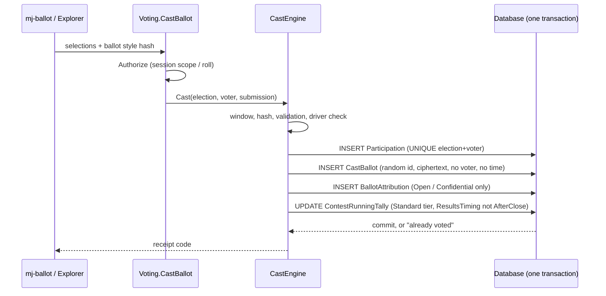

<p align="center">
  <picture>
    <source media="(prefers-color-scheme: dark)" srcset="https://github.com/MemberJunction/MJ/raw/main/MJ_logo_dark.png">
    <source media="(prefers-color-scheme: light)" srcset="https://github.com/MemberJunction/MJ/raw/main/MJ_logo.webp">
    
  </picture>
</p>

<h1 align="center">BizApps Voting</h1>

<p align="center">
  <strong>Secret, embeddable voting (motions, elections, referendums, polls) for the <a href="https://github.com/MemberJunction/MJ">MemberJunction</a> platform</strong>
</p>

<p align="center">
  <a href="#what-this-is-and-is-not">What this is</a> &middot;
  <a href="#how-a-secret-ballot-works-here">Secret ballots</a> &middot;
  <a href="#results-on-your-terms">Results</a> &middot;
  <a href="#plug-ins">Plug-ins</a> &middot;
  <a href="#the-ballot-widget">Widget</a> &middot;
  <a href="#using-it-from-code">Code</a> &middot;
  <a href="#running-it">Running it</a> &middot;
  <a href="docs/voting/known-limitations.md">Limitations</a>
</p>

---

> **Status: implemented; pre-release (`0.0.0`).** Server engines, 29 Remote Operations, the public ballot edge, the
> `<mj-ballot>` element, Explorer dashboards and a database-backed integration tier exist. It depends on two
> MemberJunction changes that are not released yet (see [Running it](#running-it)). Assurance tier C (ElectionGuard) is
> not implemented. Everything below describes what the code does today; gaps are in
> [known limitations](docs/voting/known-limitations.md). The original [design](plans/bizapps-voting-design.md) is the
> intent, not the reference.

Organizations vote in many shapes: a board passes a motion, members elect directors, a co-op ratifies a bylaw, a
standards body ballots a draft. Each needs the same guarantees: only eligible people vote, each votes once, nobody can see
how anyone else voted (unless the vote is a roll call), and the count can be reproduced and certified.

**BizApps Voting** is one voting engine for every app built on MemberJunction. It is a MemberJunction Open App
(schema `__mj_BizAppsVoting`). Other apps hold a vote by anchoring an election to one of their records and dropping a
ballot on a page.

Three ideas hold it together:

1. **The server decides everything.** Eligibility, casting, tallying and certification run in server engines behind typed
   [Remote Operations](https://github.com/MemberJunction/MJ/blob/next/guides/REMOTE_OPERATIONS_GUIDE.md). The ballot renders and submits; it decides nothing.
2. **Secret by construction, not by permission.** *Who voted* and *what was voted* live in separate tables with no link
   between them, including the timestamps, row order and audit trails a database adds by default.
3. **Configuration is data; types are plug-ins.** Election types, eligibility sources and sign-in methods are metadata
   rows naming registered driver classes.

## What this is, and is not

| This is | This is not |
|---|---|
| A voting engine for motions, elections, amendments, referendums, ratifications, polls and standards ballots | A survey tool (responses linked to respondents belong in BizApps Forms) |
| Secret ballots with a separate poll book and ballot box; Open (roll call), Confidential and Secret modes per election | A judging or scoring tool |
| An embeddable `<mj-ballot>` element for any page | A proxy-voting system for public companies |
| Plurality, majority with thresholds, approval, IRV and STV; weighted ballots | Coercion-resistant remote voting (no remote system can promise that) |
| Pluggable election types, eligibility sources and sign-in methods | Tied to any host app: nothing in the engine names one |

## How a secret ballot works here

One server operation writes the poll book and the ballot box in one transaction, as MJ's **system user** rather than the
voter:



A voter cannot be marked as having voted without a ballot, or vote twice (the unique constraint holds whatever the
sign-in method or channel). The foreign key is the easy part; secrecy is usually lost through side channels, so each is
closed explicitly:

| Side channel | Control (all verified in code/metadata) |
|---|---|
| `__mj_CreatedAt` / `__mj_UpdatedAt` columns and Record Changes rows | `TrackRecordChanges = false` on `CastBallot`, `BallotSelection`, `ContestRunningTally`, so CodeGen adds no timestamp columns ([`codegen/additional-schema-info.json`](codegen/additional-schema-info.json)); `CastBallot` carries no time |
| Insert order readable from ids or physical row order | Random `NEWID()` primary keys, declared `CLUSTERED`, on `CastBallot`, `BallotSelection`, `ContestRunningTally`: rows are stored in key order, which is random, so neither key nor physical order follows cast order |
| Anyone reading the tables through MJ | The ballot-box entities are created with **no role permissions** (`AutoAddPermissions: false`). The only grants are read/create/update (never delete) for the `Voting Ballot Engine` role, held only by MJ's system user. Deletes, user search and all-rows API access are off; no delete procedures exist |
| Writes that bypass the engines | Entity-server write guards (`BallotBoxWriteGuard`, `TallyWriteGuard`) refuse ballot-box and result writes outside the cast/tally engines; ballot selections and participations are immutable |
| Ballots saved under the voter's session | Ballots are written as the system user; the voter's identity stops at `Participation` |
| Reading votes at rest | `CastBallot.Selections` is ciphertext: `v1:a:...` (AES-256-GCM, key from `VOTING_SELECTIONS_KEY`) or `v1:b:...` (tier B, RSA-OAEP-wrapped data key) |
| A voter-to-ballot link | `BallotAttribution` rows exist only for Open and Confidential elections; a Secret election never has any |
| Logs | Casting never logs submissions or selections; errors carry codes, not ballot content |
| Unique vote weights | Ballots store a weight *class* (`1`, `1-2`, `2-5`, `5-10`, `10-100`, `100+`); the tally uses the class's mean weight; when an electorate has several weight classes and any has fewer than `WeightClassMinSize` (default 5) ballots, running totals are withheld entirely |
| Tally order | Ballots are shuffled with a CSPRNG before decryption, and the shuffled `BallotSelection` rows are written only after close |

`AllowCreateAPI` / `AllowUpdateAPI` are deliberately left **on**, and `IncludeInAPI` is left **on**: in MJ, turning either
off makes CodeGen omit the create/update procedures (and the base view) and generate a `Save()` that always throws, even
for the system user, so the cast engine could never write a ballot. Permissions, not those flags, keep the API closed.

### Secrecy modes and assurance tiers

| Mode | Stored |
|---|---|
| **Open** | Each ballot linked to its voter (`BallotAttribution`); revotes allowed if enabled; standards-ballot comments stored |
| **Confidential** | Linked to the voter like Open; for sealed-until-close committee votes |
| **Secret** | Poll book and ballot box, unlinkable; revotes never allowed |

| Tier | Status |
|---|---|
| **A: Standard** | Implemented. AES-256-GCM under `VOTING_SELECTIONS_KEY`; all controls above |
| **B: High assurance** | Implemented. Per-election RSA-3072 key pair; the private key is split k-of-n (Shamir over GF(256)) among named trustees and exists only in memory during creation and during the tally ceremony. Requires a single MJAPI instance |
| **C: Verifiable** | **Not implemented.** Refused (`TierNotSupported`) at open, cast and tally unless a `BaseVerifiableTallyProvider` is registered under the key `ElectionGuard`; none ships |

## Results on your terms

Each election sets `ResultsTiming` and `ResultsAudience` (`Voters`, `Eligible`, `HostMembers`, `Public`, `Administrators`).

| ResultsTiming | Behaviour |
|---|---|
| `AfterClose` (default) | Nothing until the election is Tallied or Certified; then the audience sees final results |
| `AfterVoting` | A voter sees running results once they have voted (after `ResultsMinCast` ballots) |
| `Live` | The audience sees running results while Open (after `ResultsMinCast` ballots) |
| `AdministratorsOnly` | Administrators see running results while Open (each view audited); everyone sees final results after the tally |

Administrators and Election Inspectors always see final results once the election is Tallied or Certified, whatever the
audience. Running results are available for Standard-tier elections only (database constraint and engine check).

Guards against inferring a vote from moving totals: running results come only from a **snapshot** published by a
scheduled job (never computed per request), at most every 5 ballots and 5 minutes by default, only once `ResultsMinCast`
(default 5) ballots exist, withheld while any weight class is smaller than `WeightClassMinSize`, and ranked contests limited to first preferences. The
certification records a disclosure of the timing and audience used. `HostMembers` is approximated as "a signed-in,
non-guest MJ user" because Voting has no host-membership concept of its own.

## Plug-ins

| Plug-in point | Base class | Ships with Voting |
|---|---|---|
| Election type (server) | `BaseElectionTypeServerDriver` (`@mj-biz-apps/voting-core-entities-server`) | Types: Motion, Board Election, Organization-wide Election, Charter/Bylaw Amendment, Referendum, Ratification, Poll, Standards Ballot. Only the default (no-op) driver is used, except Standards Ballot, which has its own server driver (`StandardsBallotServerDriver`) |
| Election type (UI) | `BaseElectionTypeUIDriver` + contribution bases (`@mj-biz-apps/voting-ng-widgets`) | Defaults, plus `StandardsBallotUIDriver` (Document step, Comments results view); contributions may add admin tabs, wizard steps and results views |
| Tally method | `BaseTallyMethodContract` (pure, deterministic) | Plurality, Majority (with thresholds), Approval, IRV, STV. The registry is a fixed record in `@mj-biz-apps/voting-entities`; adding a method means changing that package |
| Eligibility source | `BaseEligibilitySource` (`@mj-biz-apps/voting-server`) | Entity Query, CSV |
| Sign-in method | `BaseVoterCredentialMethod` (`@mj-biz-apps/voting-server`) | Emailed link, host assertion, MJ session, second factor (roster key + PIN), SSO (not accepted at the public edge) |

**Standards Ballot rules** (`StandardsBallotServerDriver`): a roll call, so `SecrecyMode` must be `Open`; every contest is a
`StandardsItem` offering exactly Approve then Disapprove; a Disapprove needs a comment (the ballot style must require one
and a cast without it is refused); opening requires the Standards Ballot details row with a `DocumentTitle` (not needed at
create, because the Document step saves that row after the election); a recirculation (`RecirculationRound` 1 or more) must
name a `Certified` prior ballot of the same type on the same document.

Details and examples: [docs/voting/extending.md](docs/voting/extending.md).

## The ballot widget

`<mj-ballot>` is an Angular custom element with no MemberJunction core code in its bundle (a build guard enforces it),
rendered in a shadow root. MJAPI serves the bundle and a first-party ballot page with a strict CSP.

```html
<script type="module" src="https://api.example.org/vote/element/main.js"></script>
<mj-ballot slug="2027-board-election" api-root="https://api.example.org/vote"></mj-ballot>
<!-- or, where scripts cannot run -->
<iframe src="https://api.example.org/vote/2027-board-election" title="Ballot"></iframe>
```

The widget exchanges one credential at `POST /vote/session` for a short-lived (30 minutes by default), election-scoped
guest session; the token stays in memory. Sign-in the **public edge** accepts:

| Method | How |
|---|---|
| **Emailed link** | Single-use token in the URL fragment (`/vote/<slug>#t=<token>`), so it never reaches server logs; the widget reads it and clears the fragment |
| **Host assertion** | The host page passes an RS256 assertion in the `host-assertion` attribute, signed by a key whose public half an administrator registered on the distribution |
| **Roster key + PIN** (`second-factor`) | The voter types a roster identifier and PIN, with durable lockout |

SSO and `mj-session` are refused at the edge (voters with an MJ login use the Explorer "My Ballot" page). The `email`
attribute is accepted but has no effect. Attributes, events and the iframe protocol: [docs/voting/embedding.md](docs/voting/embedding.md).

## Using it from code

Every operation is a typed Remote Operation: the same call works in the browser and on the server. `Execute` returns a
transport result (`Success`, `Output`, `ResultCode`, `ErrorMessage`); the operation's own outcome is in `Output`.

```typescript
import { VotingCreateElectionOperation, VotingOpenElectionOperation } from '@mj-biz-apps/voting-entities';

const created = await new VotingCreateElectionOperation().Execute({
    ElectionTypeCode: 'motion',
    Name: 'Approve the 2027 budget',
    Anchors: [{ EntityName: 'Committees: Motions', RecordID: motion.ID, Role: 'Subject', IsPrimary: true }],
    EligibilitySource: { Code: 'entity-query', Settings: { EntityName: 'Committees: Members', PersonIDField: 'PersonID' } },
    Contests: [{ Name: 'Budget', Kind: 'Motion', TallyMethodCode: 'majority', Threshold: 'TwoThirds', AllowAbstain: true }],
    SecrecyMode: 'Confidential',
    ClosesAt: '2027-01-15T17:00:00Z',
});
if (!created.Success || !created.Output?.Success) throw new Error(created.ErrorMessage ?? created.Output?.Message);

await new VotingOpenElectionOperation().Execute({ ElectionID: created.Output.ElectionID! });
```

A type driver can react to a result; `OnResultsTallied` / `OnResultsCertified` run **inside** the tally/certify
transaction, so a throw rolls the tally back:

```typescript
@RegisterClass(BaseElectionTypeServerDriver, 'CommitteeMotionDriver')
export class CommitteeMotionDriver extends BaseElectionTypeServerDriver {
    public override async OnResultsTallied(ctx: ElectionResultsContext): Promise<void> {
        if (ctx.PrimaryAnchor) await recordMotionOutcome(ctx.PrimaryAnchor.RecordID, ctx.Results, ctx.Provider, ctx.ContextUser);
    }
}
```

The 29 operations, their audiences and fields: [docs/voting/operations.md](docs/voting/operations.md).
Six Actions (Create Motion Vote, Open/Close Election, Get Turnout, Get Election Results, Tally Election) wrap the
operations for agents and workflows; there is no reminder action (reminders run as a scheduled job).

## Explorer dashboards

The **BizApps Voting** app in MJ Explorer has five pages: **Elections** (list, creation wizard, and per-election tabs:
Overview, Roll, Credentials, Turnout, Close & Tally, Certification), **My Ballot** (the signed-in user's ballot),
**Election Types** (read-only catalog of types, tally methods, eligibility sources and sign-in methods),
**Results & Certification** (results, certify, printable report, receipt check) and **Settings** (ballot distributions,
embed snippets, credential issuing). The Credentials tab issues emailed links and, for paper and PIN voting, control numbers and second-factor PINs (shown once, with CSV copy/download); the Overview tab opens and closes nominations and decides them; the Roll tab lists proxy designations and accepts or rejects them. Trustee ceremonies, comment resolution and paper-ballot entry are Remote Operations only; there is no UI for them yet.

## Repository structure

```
packages/
  Entities/             @mj-biz-apps/voting-entities       generated entities, 29 operation bases, ./contracts (pure rules, tally methods)
  EngineBase/           @mj-biz-apps/voting-engine-base    VotingEngineBase cache of types, methods, sources, sign-in methods
  CoreEntitiesServer/   @mj-biz-apps/voting-core-entities-server   entity server classes, driver base + registry, write guards
  Server/               @mj-biz-apps/voting-server         engines, operations, ballot edge, sign-in methods, jobs, crypto, bootstrap
  Actions/              @mj-biz-apps/voting-actions        six Actions calling Remote Operations
  AngularWidgets/       @mj-biz-apps/voting-ng-widgets     UI driver base, contribution bases, <mj-ballot> element
  Angular/              @mj-biz-apps/voting-ng             Explorer dashboards (L3) + generated forms
  IntegrationTests/     (private)                          database-backed integration tests
migrations/  metadata/  codegen/  docs/voting/  plans/
```

## Running it

There is no MJAPI or MJExplorer in this repo; it loads into a host MJ (on the M5 workspace, MJ's own shells).

**Prerequisites**
- **Unreleased MemberJunction changes** (pending in an MJ PR; until released, run against that MJ branch):
  1. *CodeGen applies per-table `Entities` config at entity creation, including `AutoAddPermissions`*
     (`resolveCreationTimeEntityConfig` / `resolveCreationTimeAutoAddPermissions` in `CodeGenLib`). Without it the ballot
     tables get timestamp columns and default permissions.
  2. *New `@memberjunction/server` exports*: `BuildSessionClaims`, `MagicLinkKeyManager`, `MagicLinkService`, `HashToken`,
     `GenerateRawToken`, `VerifyHostAssertion`, `IsScopeLimitedPrincipal`. The ballot edge cannot mint sessions without them.
- `bizapps-common` installed (elections reference its `Person` / `Organization` tables); `mj-app.json` declares it as the `mj-bizapps-common` dependency (`>=5.46.1 <6.0.0`).
- MJ `>=6.2.0-edge.2 <7.0.0` (`mj-app.json`).

**Install** (full recipe: [docs/template-docs/linking-to-mj.md](docs/template-docs/linking-to-mj.md))
1. Server: in the MJ root `mj.config.cjs` add a `dynamicPackages.server` entry
   `{ PackageName: '@mj-biz-apps/voting-server', StartupExport: 'LoadBizAppsVotingServer', AppName: 'mj-bizapps-voting', Enabled: true }`
   and add the package to `packages/MJAPI/package.json`. The public edge needs no host config: the package exports
   `MJ_SERVER_EXTENSIONS` and declares `memberjunction.serverExtensions` (`VotingBallotEdge`, root `/vote`) in its own `package.json`.
2. Explorer: add `@mj-biz-apps/voting-ng` to `packages/MJExplorer/package.json` and import it in the generated open-app bootstrap.
3. Run `pnpm install` **at the workspace root** (`M5/`), never in a package.
4. Database: `pnpm run mj:migrate`, then `mj sync push` for `metadata/` (types, methods, sources, roles, the Voting Ballot Engine role and its grants, scheduled jobs), then `pnpm run mj:codegen` from this repo's root.
5. `pnpm run build:packages`, then start MJAPI.

**Configuration**

| Setting | Purpose |
|---|---|
| `VOTING_SELECTIONS_KEY` | Base64 of exactly 32 bytes (`node -e "console.log(require('crypto').randomBytes(32).toString('base64'))"`). Encrypts tier A selections. **Production fails closed** (no ballots recorded) if missing or malformed; outside production a derived development key is used with a logged warning |
| MJ `magicLink.enabled: true` | Required for ballot guest sessions; the edge returns 503 when it is off. Also uses `magicLink.audience`, `widget.anonymousEmail` and the role `magicLink.restrictedRoleName` (override with the edge setting `GuestRoleName`) |
| An MJ Communication email provider | Emailed links: the `emailed-link` method's `Configuration` needs `FromAddress` (optional `ProviderName`, `FromName`, `Subject`) |
| `VOTING_EMAIL_PROVIDER`, `VOTING_EMAIL_FROM` | Reminders only (or `ProviderName` / `From` in the reminder job's Configuration). The reminder job ships **Disabled** |
| Edge extension `Settings` | `SessionTtlMinutes` (30; 1-240), `RateLimitWindowMs` (60000), `RateLimitMax` (20 per IP+slug), `RateLimitMaxGlobal` (90 per IP), `TrustedProxyHops` (0), `ApplicationName` (`BizApps Voting`), `GuestRoleName` |
| Roles | Assign `Voting Administrator` / `Election Inspector` to users. MJ `Developer` and `Integration` roles also administer |

**Scheduled jobs** (shipped in `metadata/scheduled-jobs`): *Election Scheduler* (opens Ready elections at `OpensAt`, closes Open ones at `ClosesAt`) and *Result Snapshot Publisher*, both Active every 5 minutes; *Reminder Sender* hourly, Disabled until an email provider is configured. Nothing tallies automatically.

**Develop** (M5: `pnpm install` at `M5/` only):
```bash
cd bizapps-voting
pnpm run build:packages
pnpm test                                   # unit tests (turbo)
cd packages/IntegrationTests && pnpm test:integration   # database-backed tier
```
The integration tier (ten test files covering lifecycle, cast atomicity, unlinkability, access, invariants, results timing, tier B, paper ballots, nominations/proxies/offline credentials and standards ballots) connects to a database named `MJ_Voting_Dev` (pinned in the suite) using `DB_HOST`, `DB_PORT`,
`DB_USERNAME`, `DB_PASSWORD` (and optionally `DB_TRUST_SERVER_CERTIFICATE`) from this repo's `.env`, which must hold your
own credentials and never be committed. The database needs the migration, metadata and CodeGen applied. If the database
cannot be reached the tests print `SKIPPED` rather than fail, so check the output.

## Documentation

| Document | Content |
|---|---|
| [Architecture](docs/voting/architecture.md) | Packages, cast transaction, engines, secrecy controls, tiers |
| [Operations reference](docs/voting/operations.md) | The 29 Remote Operations, audiences, fields; Actions |
| [Security and permissions](docs/voting/security.md) | Who can read or write what, the grant matrix, row-level security, the voter-operation pattern, API scopes |
| [Embedding](docs/voting/embedding.md) | `<mj-ballot>` attributes, events, sign-in, edge routes and gates |
| [Extending](docs/voting/extending.md) | Drivers, tally methods, sources, sign-in methods, UI contributions |
| [Runbook](docs/voting/operations-runbook.md) | Keys, trustee ceremony, rate limits, certification, recovery |
| [Known limitations](docs/voting/known-limitations.md) | What does not work yet |
| [Design](plans/bizapps-voting-design.md) | Original design |

## License

BUSL-1.1 (see `LICENSE`).
