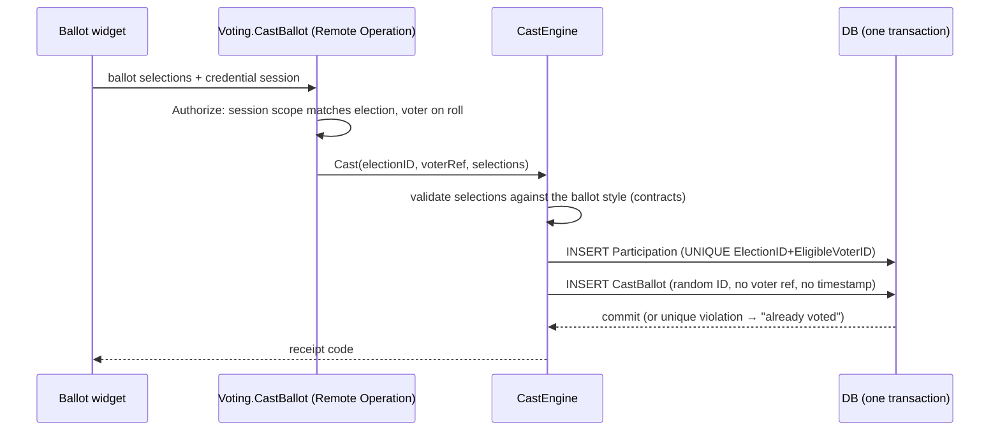

# BizApps Voting — Elections, Ballots & Motions

**Status:** design approved, build starting — v0.2 (2026-10-12) · Owner: TBD
**Repo:** [`MemberJunction/bizapps-voting`](https://github.com/MemberJunction/bizapps-voting) (MemberJunction Open App, schema `__mj_BizAppsVoting`, entity prefix `MJ_BizApps_Voting: `)
**Consumers:** bizapps-committees (2.0, on Collaboration), bizapps-collaboration spaces, and any host that needs a vote

Moved here from BlueCypress/new-products (`voting/plan.md`) when the repo was created.

---

## 1. Summary

Most organizations vote, and in many shapes:

- Boards and committees vote on motions.
- Members, owners or employees elect officers, directors and representatives.
- Constituents approve charter or bylaw amendments and answer referendums.
- Unions ratify contracts.
- Co-ops and credit unions elect boards.
- Homeowner and condo associations decide budgets.
- Student governments and faculty senates hold elections.
- Standards bodies run ballots with comment periods.
- Teams run quick polls where everyone watches the results come in.

The secrecy, eligibility and integrity problems are the same in every case.

Today the family has one place that votes: Committees' `Ballot`/`Vote` tables. They are scoped to a committee motion. Each vote is keyed to the voter's committee seat (`Vote.MembershipID`), so votes are *sealed by access control* but never *secret*: anyone with database access can see how each person voted. Committees 2.0 already plans to move its meetings onto Tasks and Collaboration. Voting is the piece that should become shared infrastructure.

**bizapps-voting** is one voting engine for the family. Its properties:

- **Server-authoritative from day one.** Eligibility, casting, tallying and certification all happen in server engines exposed through Remote Operations. The ballot UI renders and submits; it decides nothing.
- **Secret by construction.** The record of *who voted* (poll book) and the record of *what was voted* (ballot box) are separate stores, written in one transaction, with no link between them. That includes the side channels MJ adds by default.
- **Configurable by data.** Election types, contest kinds, tally methods, thresholds and secrecy modes are metadata, not code forks.
- **Hosted anywhere.** An election anchors to any record — a committee motion, a Collaboration space, a standards project — and its ballot embeds on any page. Committees, Collaboration and future apps reuse it rather than rebuild it.
- **Extensible like Collaboration.** Election types, tally methods, eligibility sources and sign-in methods are plug-ins: a metadata row naming a registered driver class, with an optional IsA extension entity (§6).

This is also the reference app for the architecture we want everywhere (see bizapps-forms#303): engines hold the logic, Remote Operations expose it, and clients stay thin.

## 2. Why a new app, not part of Forms (decision record)

**Considered:** add a "voting-strength" mode to bizapps-forms — anonymous fills, plus a guard so each person submits once.

**Rejected, because Forms is built around the opposite invariant.** Forms links a response to its respondent on purpose. It has resume-your-own-response, Person linking by email, and entity binding that writes answers onto the respondent's records. Secrecy would mean switching each of those off in voting mode and proving none leaks. The model also lacks the concepts voting needs:

- an eligibility roll frozen at a record date;
- weighted votes;
- multi-seat and ranked contests;
- tally algorithms;
- certification;
- nominations.

Forms' current architecture also computes outcomes in the browser and trusts a client-built snapshot (bizapps-forms#302, #303). Voting must not inherit that.

**What we reuse instead:**
- MJ magic links and SSO for voter credentials.
- MJ Communication for invitations and reminders.
- MJ Scheduling to open and close elections.
- MJ Encryption for data at rest.
- bizapps-common `Person`/`Organization` for voters and candidates.
- Collaboration and Committees as hosts.

The ballot widget borrows the *packaging* lessons of the Forms widget (an MJ-core-free custom element, plus a bundle guard), not its code.

## 3. Requirements (scope)

| Area | Requirements |
|---|---|
| **Kinds of vote** | Motions (yes/no/abstain); officer and director races (single- and multi-seat); bylaw amendments and referendums (with thresholds such as two-thirds); slates; write-ins; standards ballots (approve / disapprove with comments / abstain) with comment resolution and recirculation |
| **Tally methods** | Plurality; majority with a threshold over votes cast or over eligible voters; approval; ranked-choice (IRV for single seats, STV for multi-seat); weighted votes; ties by recorded lot or by administrator |
| **Eligibility** | Voter roll frozen at a record date, from a pluggable source: any MJ entity query (e.g. a membership, employee, owner or unit roster synced from a system of record), committee voting members, Collaboration space seats, or a CSV. Voting classes (e.g. only one class of voter votes for its seats). Organizational voters with a designated voting representative. Challenge and amendment of the roll, with an audit trail |
| **Phases** | Draft → Nominations (petitions, acceptance, committee approval) → Ready → Open → Closed → Tallied → Certified, plus a challenge window. Cancel at any point before certification |
| **Channels** | Online (magic link or SSO); paper and mail ballots entered by staff against control numbers; proxies with a designation deadline |
| **Operations** | Invitations and reminders to *non-voters only*; turnout and quorum tracking; results timing set per election (after close by default; live or after-you-vote for polls, see §4.5); inspector/observer role; independent-administrator mode; a certified results report; export for recount |
| **Experience** | Accessible ballot (WCAG 2.2 AA) and mobile-first; multiple languages; candidate statements and photos; ballot preview for candidates and administrators |
| **Assurance** | Secret ballot where bylaws require it; one ballot per eligible voter; immutable audit log; a receipt the voter can check; reproducible tally |

**Out of scope:**
- Government elections.
- Coercion resistance in remote voting (receipt-freeness). The doc states this limit rather than overclaim.
- Awards judging, which is scoring, not voting (Caliber / bizapps-awards).
- Surveys and polls without integrity requirements (Forms).

## 4. The secrecy model

### 4.1 Poll book and ballot box

Real elections keep two records apart:

- **Poll book** (`Participation`): *who* voted, when, and through which channel. It is needed to stop double voting, remind non-voters, measure turnout and audit eligibility.
- **Ballot box** (`CastBallot`): *what* was voted, with **no reference to the voter**.

One server operation, `Voting.CastBallot`, writes both in **one transaction**:

A voter cannot vote without being marked as having voted, and cannot be marked without voting. A second attempt fails on the unique constraint.

### 4.2 The side channels (MJ-specific)

The foreign key is the easy part. Unlinkability is usually lost through side channels, and MJ adds several by default. Each needs a control:

| Side channel | Why it links voter to ballot | Control |
|---|---|---|
| `__mj_CreatedAt` / `__mj_UpdatedAt` | CodeGen adds them to any entity with `TrackRecordChanges=1`; `Participation.CastAt` ≈ `CastBallot.__mj_CreatedAt` | `TrackRecordChanges=0` on `CastBallot` and `BallotSelection`, so no timestamp columns. Ballots carry no time at all. |
| Record Changes | A change record stores the acting user | `TrackRecordChanges=0` on ballot entities (the same switch) |
| `NEWSEQUENTIALID()` default PK | IDs sort in insert order, matching the poll book's order | `CastBallot.ID DEFAULT NEWID()`; never sequential |
| Acting user | Rows saved under the voter's `contextUser` | The cast engine writes the ballot as the **system user**; the voter's identity stops at the poll book |
| Request and audit logs | GraphQL/operation logs may capture input with the user | The cast operation logs no input; `AuditRecordAccess`/`AuditViewRuns` off for ballot entities |
| Generic API | Generated resolvers expose tables to anyone with read | `IncludeInAPI=0` on ballot entities. No role, including staff, has read on them. Only the tally engine (system user) reads them, and only after close. |
| Weighted votes | A unique weight re-identifies its voter | The weight is not stored on the ballot. Tally per weight class, and refuse to report a class with fewer than *k* voters (configurable, default 5) |
| Small electorates and live results | Results with 3 voters, or running totals that move right after a known person votes, reveal choices | Results timing is a per-election setting; the default is nothing until close. Results are suppressed below a minimum-cast threshold. When results are visible while open, they are published in batches, never per ballot (§4.5) |
| Revoting | Replacing a ballot requires finding the old one | **Secret** mode: a ballot is final. **Confidential** and **Open** modes may allow changes until close |
| Operators/DBAs, transaction logs | Anyone with database or log access can study insert patterns | Assurance tier B (below): selections are encrypted under an election key the servers never hold |

### 4.3 Secrecy modes (per election, defaulted by election type)

| Mode | Use | Stored |
|---|---|---|
| **Open** (roll call) | Board/committee votes recorded by name; standards ballots | Vote linked to the voter and visible per policy |
| **Confidential** (sealed) | Committee votes where a record is required but hidden until close (today's Committees behavior) | Linked to the voter; readable only by the voter until close, then per policy |
| **Secret** | Organization-wide elections, sensitive motions, anonymous polls | Poll book and ballot box, unlinkable |

### 4.4 Assurance tiers (per election)

- **Tier A — Standard.**
  - The secret model above.
  - Ballot selections are encrypted at rest with MJ Encryption (AWS KMS / Azure Key Vault key sources).
  - Access isolation as in §4.2.
  - The voter receipt confirms the ballot was recorded.
  - This covers most organizational elections.
- **Tier B — High assurance.**
  - Each election gets its own asymmetric key pair.
  - The private key is split among election trustees (Shamir *k*-of-*n*) in a key ceremony and is **never stored on the server**.
  - Selections are encrypted with the election public key at cast.
  - At close, trustees combine their shares in a tally ceremony. Ballots are shuffled before decryption, then tallied.
  - This protects ballot content from operators, DBAs and BC staff for the whole voting window.
  - Receipt codes are hashes of the ciphertext, published after close, so voters can confirm inclusion.
- **Tier C — Verifiable (later).**
  - Integrate ElectionGuard (open-source, from Microsoft): homomorphic tally, voter tracking codes, and public verification artifacts anyone can check.
  - Positioned for elections that need independent verification.

Tier A ships first. Tier B is the differentiator for high-stakes elections.

### 4.5 Results while voting is open

Some votes should show results as they come in. A team poll is the obvious case. Some ballots show each voter the results after they have voted. This is a per-election setting, `ResultsTiming`, defaulted from the election type, with `ResultsAudience` saying who may see the results:

| ResultsTiming | Who sees running results | Typical use |
|---|---|---|
| `AfterClose` (default) | Nobody; turnout only | Elections, motions, amendments |
| `AfterVoting` | Each voter, once they have cast | Polls where seeing results first would sway the undecided |
| `Live` | Everyone in `ResultsAudience`, throughout | Open polls, straw votes |
| `AdministratorsOnly` | Administrators, for monitoring; every view is audited | Rarely; disclosed in the certification report |

Running results don't touch ballot secrecy: the poll book and ballot box stay unlinked. They do open a **differencing channel**: if you know who just voted, from the poll book or from watching a colleague, and you see the totals move, you learn their vote. When results are visible while open:

- **Threshold.** Nothing is shown until `ResultsMinCast` ballots are in (default 5). The same k-threshold applies per weight class.
- **Batching.** Totals are published as snapshots — after every N ballots and no more often than every T minutes (`LiveRefreshPolicy`) — never per ballot.
- **No poll book in the same view.** The engine refuses to show the poll book to an audience that also sees live results, unless the election is in Open (roll-call) mode, where votes are public anyway.
- **Ranked methods.** Live views show first preferences only, clearly labeled; the full IRV/STV count runs at close.
- **Assurance tiers.** Live and after-vote results are Tier A only. Under Tier B and C, ballots can't be read before the trustee ceremony, so the engine refuses the combination.
- **Disclosure.** The certification report states the results timing that applied.

**Implementation:**

- The cast engine increments a `ContestRunningTally` row per option, in the same transaction as the ballot.
- A scheduled job materializes a `ResultSnapshot` by the batch policy.
- `Voting.GetResults` serves the latest snapshot to the authorized audience. It never serves a live count.

## 5. Domain model

Schema `__mj_BizAppsVoting`. Types and kinds are lookup tables seeded as metadata, so new vocabulary is data, not code.

| Entity | Key fields | Notes |
|---|---|---|
| `ElectionType` | Code, Name, ServerDriverClass, UIDriverClass, ElectionExtensionEntity, Configuration (JSONType: defaults such as secrecy mode, assurance tier, results timing, allowed contest kinds and credential methods, plus which keys an election may override) | A plug-in point (§6). Seeded generic types: Motion, Board Election, Organization-wide Election, Charter/Bylaw Amendment, Referendum, Ratification, Poll, Standards Ballot. Apps ship their own |
| `Election` | Name, ElectionTypeID, SecrecyMode, AssuranceTier, Status, RecordDate, OpensAt, ClosesAt, TimeZone, ResultsTiming (AfterClose / AfterVoting / Live / AdministratorsOnly), ResultsAudience (Voters / Eligible / HostMembers / Public / Administrators), ResultsMinCast, LiveRefreshPolicy, Configuration (JSONType: overrides of the type's defaults) | The container. Columns are what SQL reads; everything else is configuration. A committee motion is a one-contest election anchored to the motion |
| `ElectionAnchor` | ElectionID, EntityID (FK `__mj.Entity`), RecordID, Role, IsPrimary, Sequence | The records an election belongs to (a motion and its meeting, a space, a standards project), the same shape as Collaboration's `SpaceAnchor` |
| `Contest` | ElectionID, Sequence, Kind (Motion / Office / Question / Amendment / StandardsItem), Seats, TallyMethodID, Threshold, ThresholdBasis (VotesCast / Eligible), AllowAbstain, AllowWriteIn, MinSelections, MaxSelections, VotingClassFilter | One ballot item |
| `TallyMethod` | Code, Name, DriverClass (ClassFactory key under `BaseTallyMethod`), Configuration, Description | Seeded: Plurality, Majority with threshold, Approval, IRV, STV. A new method is a registered class plus a row (§6) |
| `ContestOption` | ContestID, Label, CandidatePersonID (nullable), StatementFileID, PhotoFileID, Sequence, IsWriteIn | Candidates or choices |
| `Nomination`, `NominationEndorsement` | ContestID, NomineePersonID, NominatedByPersonID, Status (Submitted / Accepted / Declined / Approved / Withdrawn) | Petition signatures as endorsements |
| `EligibilitySourceType` | Code, Name, DriverClass (key under `BaseEligibilitySource`), Configuration | Where a roll comes from. Voting ships Entity Query and CSV; Committees and Collaboration ship their own (§6) |
| `VoterCredentialMethod` | Code, Name, DriverClass (key under `BaseVoterCredentialMethod`), Configuration | How a voter proves who they are: Emailed Link, Host Assertion, SSO, MJ Session, plus an optional second factor (§9) |
| `EligibleVoter` | ElectionID, PersonID, RepresentingOrganizationID, VotingClass, Weight, SourceKey (the voter's ID in the source system), Status (Eligible / Challenged / Removed) | The roll, frozen at RecordDate; amendments audited |
| `VoterCredential` | EligibleVoterID, VoterCredentialMethodID, MagicLinkInviteID, ControlNumberHash, IssuedAt, RedeemedAt, RevokedAt | One active credential per method; paper and proxy use control numbers |
| `BallotDistribution` | ElectionID, Slug, PublicKey, Status, AllowedOrigins, AllowedCredentialMethods, HostPublicKey (PEM, set by an administrator), Theme (JSON) | One per place the ballot is embedded, like Orders' and Forms' distributions (§9) |
| `ProxyDesignation` | ElectionID, GrantorEligibleVoterID, ProxyPersonID, Scope, ReceivedAt | Deadline enforced by the engine |
| `Participation` (poll book) | ElectionID, EligibleVoterID, CastAt, Channel, EnteredByUserID (paper/proxy), **UNIQUE(ElectionID, EligibleVoterID)** | The only place the voter's identity meets the election |
| `CastBallot` (ballot box) | ID (`NEWID()`), ElectionID, BallotStyleHash, ReceiptCode, Ciphertext / EncryptedSelections | `TrackRecordChanges=0`, `IncludeInAPI=0`, no voter reference, no timestamp |
| `BallotSelection` | CastBallotID, ContestID, OptionID / Rank / WriteInText (encrypted) | Only for Tier A plaintext-after-decrypt tallies; absent in Tier B (ciphertext only) |
| `ContestResult` | ContestID, OptionID, Votes (weighted), RoundsJSON (IRV/STV), Outcome, TieBreakSeed, ComputedAt | Written only by the tally engine after close |
| `ContestRunningTally` | ContestID, OptionID, Count (weighted) | Only when results are visible while open; first preferences for ranked contests; `TrackRecordChanges=0`, `IncludeInAPI=0` |
| `ResultSnapshot` | ElectionID, SnapshotAt, BallotCount, Results (JSON) | Batched publication for running results (§4.5) |
| `ElectionCertification` | ElectionID, CertifiedByPersonID(s), CertifiedAt, ReportFileID, RollHash, BallotSetHash | The result of record |
| `ElectionAuditEvent` | ElectionID, EventType, ActorUserID, At, Details (JSON) | Append-only; never contains ballot content |
| `ElectionTrustee`, `TrusteeKeyCommitment` | ElectionID, TrusteePersonID, PublicShare, Commitment | Tier B; private shares never stored |
| `BallotComment`, `CommentResolution` | Standards ballots: linked to a contest and the voter's Open-mode vote | Phase 3 |

**Invariants**, enforced in entity server subclasses (`ValidateAsync`/`Save`) so every caller gets them:
- Configuration (contests, options, roll) is immutable once an election is Open, except audited roll amendments.
- Status moves only along the state machine.
- `CastBallot` and `BallotSelection` cannot be created except by the cast engine, and never updated or deleted, except by a retention purge after the retention period.
- `ContestResult` is writable only by the tally engine after Closed.

## 6. Extensibility: election types as plug-ins

`ElectionType` follows bizapps-collaboration's `SpaceType` model (`bizapps-collaboration/docs/EXTENSIBILITY_PLAN.md`), which itself follows bizapps-orders' `ProductType`. A type is a metadata row that can name three things an app ships:

| Column | Meaning |
|---|---|
| `ServerDriverClass` | ClassFactory key under `BaseElectionTypeServerDriver`. Empty means the base driver |
| `UIDriverClass` | ClassFactory key under `BaseElectionTypeUIDriver`. Empty means the base driver |
| `ElectionExtensionEntity` | The MJ entity name of an IsA (disjoint) child of `Election` that every election of this type has, for typed data and its form: e.g. a standards body's `StandardsBallot` with document version and recirculation round. Empty means a plain election |
| `Configuration` | The type's rules and defaults (`IElectionTypeConfiguration`), an MJ JSONType column. `Election.Configuration` holds overrides of the keys the type allows. Resolved app default → type → election |

**Where a setting goes** (Collaboration's rule):
- If SQL reads it (row-level security, the poll book and ballot box filters, joins), it's a column. That's why `SecrecyMode`, `AssuranceTier`, `ResultsTiming` and `Status` are columns on `Election`.
- If it points at a record that can be deleted, it's a row with a foreign key.
- Otherwise it goes in `Configuration`.

**Server driver hooks.** Every hook has a working default, so a type overrides only what it needs. Each receives a context with the acting user, the provider (which owns the open transaction), the election, its type, the effective configuration and the change.

| Area | Validate (can refuse) | React |
|---|---|---|
| Election lifecycle | `ValidateElectionChange`: Create, Update, Open, Close, Cancel, Certify | `OnElectionChanged` |
| Roll | `ValidateRollChange` (freeze, amend, challenge) | `OnRollFrozen` |
| Ballot style | `ValidateBallotStyle`, e.g. a standards ballot requires a comment with every Disapprove | `BuildBallotStyle`, which adjusts presentation |
| Casting | `ValidateCast`, which sees selections plus voting class and weight, never the voter's identity in Secret mode | none: nothing reacts to an individual ballot |
| Results | | `OnResultsTallied`, `OnResultsCertified`. Example: Committees writes `Motion.Outcome` through `provider.RunAfterCommit` |

**Other plug-in points**, each a lookup row with a `DriverClass`, the way Orders does subscription and revenue-recognition types:
- **`TallyMethod` → `BaseTallyMethod`.** Pure, deterministic, registered in `voting-entities` so the server, tests and previews share one implementation.
- **`EligibilitySourceType` → `BaseEligibilitySource`.** Committees ships "committee voting members as of a date" and Collaboration ships "space seats", without Voting naming either.
- **`VoterCredentialMethod` → `BaseVoterCredentialMethod`** (§9).

**UI driver and contributions.**
- `BaseElectionTypeUIDriver` lives in `voting-ng-widgets` (L2: no router, no Explorer imports). Like Collaboration's, it receives the default lists and returns the final ones: admin tabs, setup wizard steps, the details form, result views and the vocabulary.
- Any app can add a tab, card or results view to any type with `@RegisterClassEx` and `spaceTypes`-style metadata (`electionTypes: ['…']`). Only the type's own driver may replace a built-in part.
- The public ballot widget doesn't load UI drivers: it is MJ-core-free (§9). A type changes what voters see through `BuildBallotStyle` on the server, which the widget renders.

**Lessons copied from Collaboration, so we don't relearn them:**
- **Missing drivers.** Resolve drivers with `ClassFactory.TryCreateInstance` and check `Resolved`, because `CreateInstance` silently returns the base class for an unregistered key. A type naming a driver that isn't registered refuses writes to its elections, with a message naming the class; reads keep working.
- **Driver state.** Drivers hold no state: one cached instance per class in a `BaseSingleton` registry, cleared when an `ElectionType` row is saved.
- **Where hooks run.** Validate hooks run in `ValidateAsync`, so `Save()` returns false with the driver's message. Reactions run inside the save's transaction, and outside work (email, HTTP) goes through `provider.RunAfterCommit`.
- **Drivers never grant reads.** Ballot and poll-book access stays in SQL filters and the engines.
- **IsA subtypes.**
  - Subtype tables never reuse an `Election` column name, or CodeGen skips the inherited fields.
  - Each role's read on a subtype uses the same row filter as `Election`; the type save checks it.
  - Deletes cascade from subtype to election.
  - Register an `EntitySubtypeResolver` on `Election` that reads the type's `ElectionExtensionEntity`; without it, `EnsureISAChild()` falls back to "the only subtype".
- **Consumer blindness.** A check fails CI when a downstream app's name appears in Voting's packages or metadata. Examples live in a private package that only tests and the gallery load.

## 7. Architecture

| Package | Tier | Holds |
|---|---|---|
| `voting-entities` | shared | Generated entities; `contracts/`: pure tally algorithms (with published test vectors), ballot-style validation, eligibility-rule evaluation, the receipt format; generated Remote Operation bases |
| `voting-engine-base` | shared | `VotingEngineBase` (`BaseEngine`): cached types, methods and kinds for the admin UI |
| `voting-core-entities-server` | server | Entity server subclasses with the invariants above |
| `voting-server` | server | Engines, Remote Operations, the public ballot edge (a pre-auth server extension, §9) and bootstrap |
| `voting-actions` | server | Thin Actions for agents and workflows ("Open election", "Get turnout"); they call engines directly |
| `voting-ng-widgets` | client (L2) | `BaseElectionTypeUIDriver`, contributions' base classes, and the `<mj-ballot>` custom element with its own MJ-core-free entry and bundle |
| `voting-ng` | client (L3) | Admin dashboards in Explorer |

**Engines (server):**
- `ElectionAdministrationEngine`: configure, validate, open, close, cancel.
- `VoterRollEngine`: build and freeze the roll through the election's eligibility source driver (`BaseEligibilitySource`, §6). Voting ships two sources: an MJ entity query (e.g. a membership, employee or owner roster as of RecordDate, synced from whatever system of record the organization uses) and CSV. Other apps ship theirs.
- `CredentialEngine`: bulk-issue and revoke voter credentials; run the credential method drivers that turn a link, an assertion or a login into a roll entry (§9).
- `CastEngine`: the single cast transaction (§4.1), plus staff entry of paper and proxy ballots against the poll book.
- `TallyEngine`: decrypt (Tier A key source; Tier B trustee shares), shuffle, and run the `contracts` algorithms. Deterministic tie-break with a recorded seed.
- `CertificationEngine`: report, hashes, sign-off.
- `NominationEngine`: nominations, petitions and acceptance.
- `ReminderEngine`: invitations and non-voter reminders from the poll book, via MJ Communication.

**Remote Operations** (each with `Authorize`):

| Audience | Operations |
|---|---|
| Voter (scope-limited sessions opt in) | `Voting.GetMyBallot`, `Voting.CastBallot`, `Voting.GetMyParticipation`, `Voting.SubmitProxy`, `Voting.SubmitNomination` |
| Results audience | `Voting.GetResults`: running results (per ResultsTiming / ResultsAudience, threshold and batching applied) or final/certified results; `Voting.VerifyReceipt` |
| Administrator | `Voting.CreateElection`, `Voting.FreezeRoll`, `Voting.AmendRoll`, `Voting.IssueCredentials`, `Voting.OpenElection`, `Voting.CloseElection`, `Voting.GetTurnout` (no partial results), `Voting.EnterPaperBallot`, `Voting.Tally`, `Voting.Certify` |
| Trustee (Tier B) | `Voting.SubmitKeyShare` |

**Ballot widget** `<mj-ballot>` (packaging, sign-in and embedding in §9):
- It renders the server-provided ballot style, gives UX-only validation hints, submits, and shows the receipt.
- No tally logic, no eligibility logic, and no data beyond the voter's own ballot style and the results it is allowed to see.
- WCAG 2.2 AA with tested keyboard and screen-reader paths; localizable strings.

**Admin UI:** Explorer dashboards with the standard chrome:
- an election wizard;
- roll review and challenges;
- a credential issuance log;
- live turnout and quorum (no results);
- the close / tally / certify flow;
- the certification report.

## 8. Integration with hosts

- **Committees 2.0.**
  - Committees ships its own `ElectionType` (Committee Motion), with a server driver and an eligibility source ("committee voting members as of a date").
  - A motion's vote becomes a one-contest election anchored to the motion and its meeting: Confidential by default, Open when the committee records roll calls.
  - The type's driver writes the result back to `Motion.Outcome` in `OnResultsTallied`.
  - Committees' `Ballot`/`Vote` tables and `BallotService` thresholds retire. The thresholds become `TallyMethod`/`Threshold` data here.
  - Quorum stays a committee rule, fed in as election config.
- **Collaboration.**
  - Any space can anchor an election (a space-level poll with integrity, a referendum in a community space).
  - Collaboration ships the "space seats" eligibility source, and a needs-you provider that lists a seat's open ballots.
  - Inside a space, the ballot uses the signed-in session (§9.2, MJ session).
- **Systems of record.**
  - Organization-wide elections need "who may vote, in which class, with what weight, as of the record date".
  - That comes from whatever the organization already uses (a membership system, HRIS, owner or unit register, student information system), synced into MJ.
  - Voting defines the `IEligibilitySource` contract and doesn't own the roster.

## 9. The ballot widget and voter sign-in

The ballot has to work anywhere: on an organization's public site, inside a member or employee portal, from an emailed link, inside Collaboration and inside Explorer. It is closest to Orders' checkout widget, with one big difference. A checkout serves anyone who will pay. A ballot serves only a person on the roll, once.

### 9.1 What we reuse

| Piece | From | Use |
|---|---|---|
| Distribution + slug + first-party host page with a nonce CSP + element bundle served by MJAPI + `allowedOrigins` + DOM events carrying no personal data | Orders' checkout (`OrdersCheckoutEdge`, `<mj-orders-checkout>`) and Forms (`/f/:slug`, `<mj-form>`) | Same shape: `GET /vote/:slug`, `GET /vote/element/main.js`, `<mj-ballot slug="…">` |
| A pre-auth public edge loaded from the app's `MJ_SERVER_EXTENSIONS` | Orders | The voting edge mounts the same way, with no host config to copy |
| Short-lived guest JWT minted with MJ's magic-link key, validated by MJ's `magic-link` auth provider, scope-limited principal | MJ `WidgetSessionService` (public chat widget) | Voter sessions are election-scoped guest sessions; the voter operations opt in to scope-limited principals |
| Host-signed RS256 identity assertion, verified against a key an administrator registered out of band, at most 10 minutes old | MJ `HostIdentityProvider` | The "already signed in to our portal" path |
| Single-use, expiring invites | MJ magic links (`MaxUses=1`) | Emailed ballot links |
| An MJ-core-free element bundle with a CI guard | Forms' widget (#245) | Same guard for `<mj-ballot>` |

### 9.2 How a voter gets a session

The widget calls one endpoint, `POST /vote/session`, with the distribution's slug and a credential. The edge:
1. resolves the distribution;
2. enforces the origin allowlist and a durable rate limit;
3. asks the credential method's driver to verify the credential and name the roll entry;
4. mints a short-lived guest JWT scoped to that election.

From then on the widget calls the voter Remote Operations (`GetMyBallot`, `CastBallot`, `GetResults`) through MJ's generic `ExecuteRemoteOperation` with that token, using a small fetch client. The token lives in memory only: never in page HTML, never in `localStorage`, never in a cookie. That means no third-party cookies are needed inside an iframe.

| Method | How the voter proves who they are | Notes |
|---|---|---|
| **Emailed link** (default) | A single-use, election-scoped token in the URL **fragment** (`/vote/:slug#t=…`), which the widget posts to `/vote/session` | A fragment never reaches server logs or referrers. Single-use: a forwarded link that was already used is refused. Needs bulk issuance |
| **Host assertion** | The organization's portal, where the voter is already signed in, signs a short-lived RS256 assertion (`aud` = the distribution's key; email and/or roster ID) and sets it on the element | Verified with `HostIdentityProvider` against `BallotDistribution.HostPublicKey`. The key comes from an administrator, never the request. The assertion is matched to the roll by roster ID, then email |
| **SSO** | WorkOS or Auth0 hosted login (popup or redirect) brokering the organization's IdP | Matched to the roll by external ID, then email |
| **MJ session** | A user already signed in to Explorer or Collaboration | No guest mint: the operations see a normal user, matched to the roll through their Person record (the family's open Person↔login question) |
| **Second factor** (optional, layered on any of the above) | A roster identifier plus a PIN or date of birth | Durable rate limit and lockout per roll entry |
| **Paper and proxy** | Staff entry against a control number | Not the widget. The poll book records `EnteredByUserID` |

**However many sessions a voter opens, one ballot.** The poll book's unique constraint enforces it. A paper and an online ballot for the same voter collide there too, and policy decides which counts (default: first cast wins).

### 9.3 Embedding

- **Custom element** on any page: a script tag plus `<mj-ballot slug="…" api-root="…">`, with optional `host-assertion` and `email` attributes. Style isolation is the element's job; Forms' review found its "own shadow root" claim was not true, so we use real Shadow DOM here.
- **Iframe** to `/vote/:slug` for sites that can't run scripts:
  - `frame-ancestors` comes from the distribution's allowlist;
  - a `postMessage` height protocol, so the frame fits its content;
  - the same events, relayed.
- **Inside Angular hosts** (Collaboration, Explorer, portals built on MJ): the same component, using the signed-in session.
- **Events for the host page:** `ballot-state-change`, `ballot-cast` (receipt code only), `ballot-error`, `ballot-close`. No event carries a name, email or choice, since every script on the host page can read them.

### 9.4 Pitfalls we design out

| Risk | Control |
|---|---|
| A bearer token in page HTML, readable by any script on the host page or kept in its cache | The token is minted at runtime and held in memory; links carry it in the fragment |
| Replaying a link or an assertion | Links are single-use and expire. Assertions are at most 10 minutes old, bound to the distribution's audience and matched to one roll entry. One ballot per voter regardless |
| Clickjacking the iframe | `frame-ancestors` from the allowlist; the Cast button needs a confirmation step |
| A host forging assertions for voters | The key is registered by an administrator. The election's audit log records the method each participation used, and the certification report counts by method |
| Rate limits that multiply with API instances (found in Forms) | Durable rate limits and lockouts, in the database or MJ's shared cache, not process memory |
| Third-party cookie blocking in iframes | No cookies |

**Upstream suggestion.** MJ's `WidgetSessionService` is tied to `MJ: Conversation Widget Instances`. Orders, Forms and Voting each built their own public edge. A generic MJ "public widget instance + session mint" would serve all of them: a key, an origin allowlist, an auth strategy (Anonymous, magic link, host identity) and a scope builder that the app plugs in. Until then, Voting's edge follows Orders' shape and calls MJ's magic-link and host-identity pieces directly.

## 10. Tally methods

- All algorithms are pure functions in `contracts`, deterministic and reproducible from the ballot set, the method and the tie-break seed.
- **Required test vectors:**
  - hand-computed cases for every method;
  - published IRV/STV datasets;
  - property tests (e.g. adding a ballot for X never reduces X's plurality count).
- **STV:** pick one variant (Meek, or Scottish STV) and document it. Different counting rules give different results, so bylaws must name the rule.
- **Abstentions:** count toward participation and quorum, never toward the threshold numerator. Whether they count in the denominator is set per contest by `ThresholdBasis`.

## 11. Compliance notes (counsel to confirm per client)

- The rules come from the organization's governing documents and the law that applies to it: corporate, nonprofit, cooperative, labor or condominium statutes, varying by jurisdiction.
- Some allow electronic voting only when the governing documents permit it. Some require a paper option on request, or specific notice periods.
- The election type should carry the governing-document citation, the notice period and the paper-option setting.
- Regulated public-company proxy voting and government elections are out of scope.
- **Retention.**
  - Keep the poll book and the certification for N years per bylaws.
  - Destroy decryption material after the challenge window.
  - Purge ballots per policy.
- **Accessibility:** a VPAT for the ballot widget is a sales requirement for larger organizations and the public sector.
- This doc is not legal advice.

## 12. Phasing

| Phase | Ships | Unlocks |
|---|---|---|
| **P0 — Motions** | Election/Contest/Option, the type plug-in model (§6), Open + Confidential modes, yes/no/abstain with thresholds, rolls from committee or space, voting with an MJ session inside Explorer and Collaboration, Committees 2.0 and Collaboration hosting | Committees drops its own ballot code |
| **P1 — Secret organization-wide elections (Tier A)** | Poll book / ballot box, every §4.2 control, bulk credentials, plurality and multi-seat, referendums and amendments, reminders, turnout, results timing (§4.5), certification report; the public `<mj-ballot>` widget with emailed links and host assertions | Officer/director elections, charter and bylaw votes, ratifications |
| **P2 — Full election management** | Nominations and petitions, IRV/STV, weighted and organizational-representative voting, SSO and second-factor sign-in, proxy and paper entry, inspector role, multi-language | Replaces election vendors outright |
| **P3 — High assurance + standards** | Tier B trustee keys and ceremonies, receipt verification; standards ballots with comments, comment resolution and recirculation | High-stakes elections; standards bodies (an identified, under-served sub-ICP) |
| **P4 — Verifiable** | Tier C (ElectionGuard) | Independent verification |

## 13. Dependencies

- **MJ core:**
  - scope-limited (guest) principals refused on execution resolvers by default, with an opt-in for specific Remote Operations (in progress);
  - bulk magic-link issuance and an exported `MagicLinkService` (Forms needs the same export);
  - `HostIdentityProvider` reused as-is for host assertions;
  - suggested: a generic public-widget session mint, generalizing `WidgetSessionService` beyond conversations (§9.4);
  - confirm that `TrackRecordChanges=0` and `IncludeInAPI=0` per entity behave as §4.2 needs.
- **bizapps-common:** `Person`/`Organization`. The Person↔login binding is still an open family-wide question (Common deprecated `Person.LinkedUserID`).
- **A synced roster** (membership, employee, owner or unit data) for organization-wide rolls.
- **PostgreSQL:** T-SQL migrations only in feature PRs. The PG counterparts come from the release-time conversion, which must cover this app from its first release.

## 14. Testing strategy

- **Unit (contracts):** every tally method against test vectors; ballot-style validation; eligibility rules.
- **Engine:** cast is all-or-nothing; a second cast is refused; paper versus online collision; roll freeze; state machine; tally determinism.
- **Unlinkability suite** (integration, against a real database), run on every PR:
  - after N casts, assert no column, ID order, record-change row, audit row or log entry joins a `Participation` row to a `CastBallot` row;
  - assert ballot entities have no `__mj_` timestamp columns and are absent from the GraphQL schema;
  - assert no role but the system user can read them.
- **Authorization:**
  - a guest can call only the voter operations for their own election;
  - staff cannot read ballots before close;
  - results follow `ResultsTiming` and `ResultsAudience` exactly, with the threshold and batching applied (§4.5).
- **Widget and sessions:**
  - each credential method mints a session only for a voter on that election's roll;
  - a used link is refused;
  - a stale or wrong-audience assertion is refused;
  - an assertion signed with any key but the distribution's is refused;
  - the element bundle contains no MJ core code;
  - no event carries personal data;
  - the iframe refuses an origin outside the allowlist.
- **Accessibility:** automated axe checks plus a manual screen-reader pass on the widget.

## 15. Open questions

1. Revoting in Confidential mode: allow changes until close (more forgiving) or final on submit (simpler)? Proposed: configurable, default final.
2. Minimum-cast threshold for reporting (k-anonymity), and the weight-class bin size: defaults 5 and 5?
3. Results timing and audience defaults per election type. Proposed: elections and motions AfterClose to Voters; Poll Live to Voters.
4. Commercial posture: free core (motions, P0–P1) with hosted Tier B/C as paid? This ties to the open-core decision for Committees.
5. Should the poll book (who voted) be visible to voters? Some bylaws publish it; others treat it as private. Proposed: an election setting, default private.
